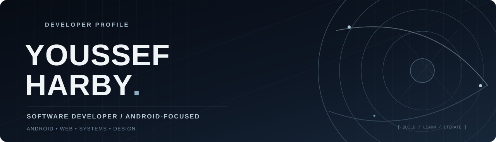

<!--
  YOUSSEF HARBY / GITHUB PROFILE
  Replace the README.md in github.com/youssif-Hy/youssif-Hy
  and upload assets/profile-hero.svg alongside it.
  Designed for GitHub's native Markdown renderer (no JavaScript required).
-->

<p align="center">
  
</p>

<p align="center">
  <strong>Building thoughtful digital products with clean code, useful design, and a problem-solving mindset.</strong>
</p>

<p align="center">
  <a href="https://youssif-hy.github.io/Youssef_Harby_Portfolio/"></a>
  <a href="https://www.linkedin.com/in/youssef-harby-0111b6326/"></a>
  <a href="mailto:youssif2371@gmail.com"></a>
  <a href="https://codeforces.com/profile/youssif_hy1"></a>
</p>

---

### 01 / ABOUT

I'm **Youssef Harby**, a **Software Developer** and third-year **Computer Science student at Assiut National University, Egypt** (expected graduation: **2028**).

My main focus is **Android development** using **Kotlin**, **Jetpack Compose**, and the Android ecosystem. I also work across **web development, C# applications, databases, and UI/UX design**. I enjoy taking a product from an early idea to a working, maintainable implementation.

- **Currently focused on:** Android engineering, API integration, app architecture, and practical project delivery.
- **Experience beyond mobile:** Responsive web experiences, console-based information systems, and interface design.
- **Community:** Leadership and student-development work with **The Helpers AC**.
- **Open to:** Software engineering and Android internship opportunities, team projects, and meaningful collaborations.

### 02 / TECHNICAL TOOLBOX

**Android & mobile**


**Languages & software fundamentals**


**Web & design**


**Tools & data**


### 03 / SELECTED WORK

<table>
  <tr>
    <td width="50%" valign="top">
      <h3><a href="https://github.com/youssif-Hy/NewsApp">01 — News App</a></h3>
      <p><strong>Android · Kotlin · Retrofit</strong></p>
      <p>Android news reader with category-based browsing, country selection, pull-to-refresh, and article sharing, powered by NewsAPI.</p>
      <p><a href="https://github.com/youssif-Hy/NewsApp">View repository →</a></p>
    </td>
    <td width="50%" valign="top">
      <h3><a href="https://github.com/Ahmed-Hekal-01/RickAndMorty-app">02 — Rick &amp; Morty App</a></h3>
      <p><strong>Android · Jetpack Compose · Firebase</strong></p>
      <p>Collaborative Android project with character browsing, search, filtering, pagination, Firebase authentication, and MVI-based state management. <em>Team project; linked to a teammate's repository.</em></p>
      <p><a href="https://github.com/Ahmed-Hekal-01/RickAndMorty-app">View team repository →</a></p>
    </td>
  </tr>
  <tr>
    <td width="50%" valign="top">
      <h3><a href="https://github.com/youssif-Hy/University-system">03 — Y.H.B University System</a></h3>
      <p><strong>C# · OOP · File I/O</strong></p>
      <p>University management console app with student/admin flows, record management, authentication logic, and GPA features.</p>
      <p><a href="https://github.com/youssif-Hy/University-system">View repository →</a></p>
    </td>
    <td width="50%" valign="top">
      <h3><a href="https://github.com/youssif-Hy/Youssef_Harby_Portfolio">04 — Developer Portfolio</a></h3>
      <p><strong>Web · UI/UX · Frontend</strong></p>
      <p>My personal portfolio for showcasing Android, web, system, and design work. The visual experience is being redesigned.</p>
      <p><a href="https://youssif-hy.github.io/Youssef_Harby_Portfolio/">Explore website →</a></p>
    </td>
  </tr>
</table>

**More from my work:** [Hospital Management System](https://github.com/youssif-Hy/Hospital-Management-System) · [El-Menshawy Web Project](https://github.com/youssif-Hy/AL-Minshawi-Shop) · [Mini Fitness Tracker](https://github.com/youssif-Hy/Mini-Fitness-Tracker) · [All public repositories](https://github.com/youssif-Hy?tab=repositories)

**Other recent work:** The Helpers Community website (private source), freelance Android UI/XML delivery, and *Aqari* — a real estate **mobile UI/UX concept**, not a deployed application.

### 04 / TRAINING & COMMUNITY

| Experience | Focus |
| :--- | :--- |
| **Digital Egypt Pioneers Initiative (DEPI)** · Completed 2026 | Android app development, Kotlin, Jetpack Compose, engineering fundamentals |
| **NTI UX/UI Program** | UX research, user flows, prototyping, Figma · 120 hours |
| **Sprints × Microsoft** | Web development fundamentals · 40 hours |
| **The Helpers Summer Camp II** · 2025 | Advanced C#, OOP, databases, technical teamwork |
| **The Helpers AC** · Leadership | Student community organization, mentoring support, and team coordination |

### 05 / ENGINEERING APPROACH

```text
Understand the problem → Design the experience → Build the solution
        → Test the behavior → Improve what matters
```

I care about **readable code, intentional interfaces, clear collaboration, and continuous learning**. My long-term direction is to become a stronger Android and software engineer by shipping practical applications and understanding the systems behind them.

<details>
<summary><strong>GitHub activity</strong> — expand to see contribution trends</summary>

<br />

<p align="center">
  
</p>

</details>

---

<p align="center">
  <strong>Build with clarity. Ship with purpose.</strong><br />
  <sub>Based in Egypt · <a href="mailto:youssif2371@gmail.com">Let's connect</a> · Youssef Harby</sub>
</p>
